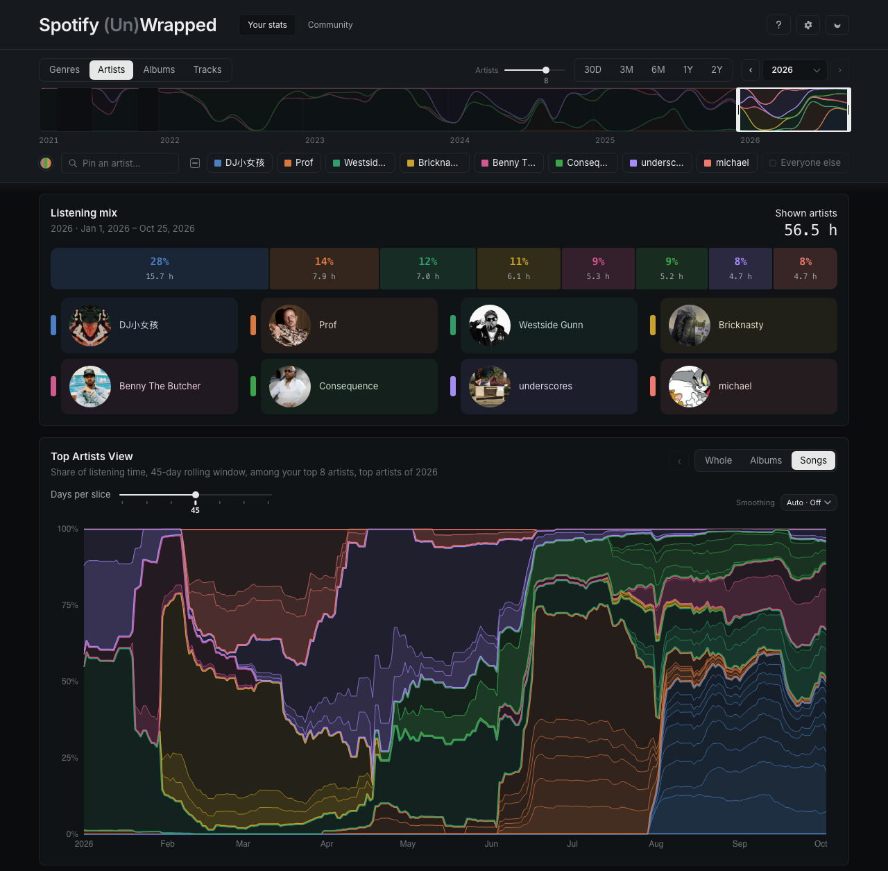
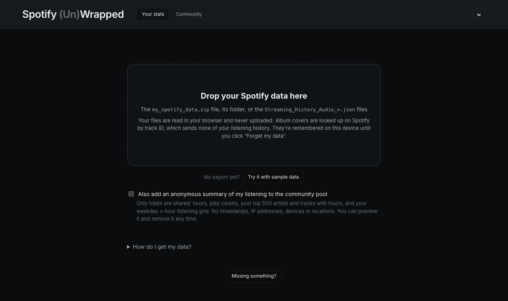
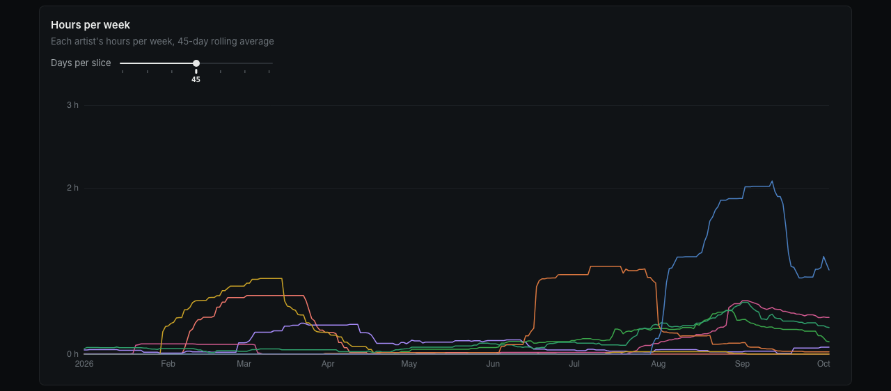
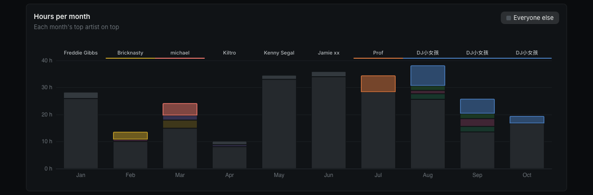
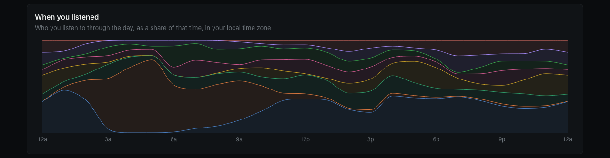
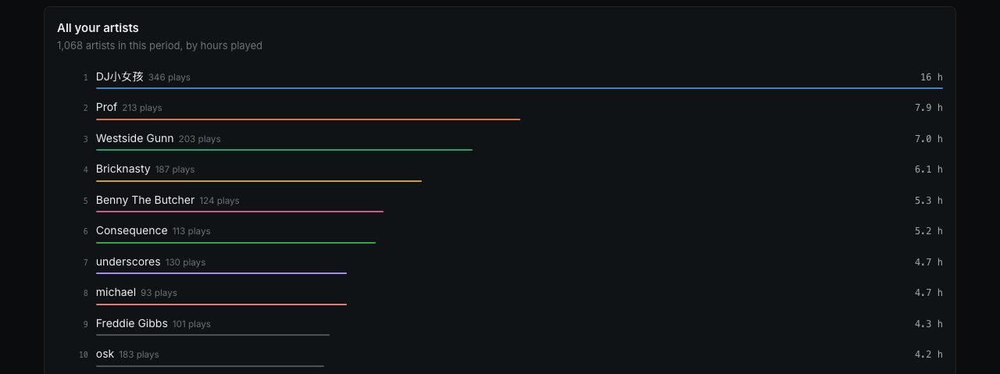

# Spotify (Un)Wrapped

Spotify Wrapped is interesting but shallow. Turns out if you have Premium, you can access all the data they use to make your Wrapped, for free. **(Un)Wrapped** then creates beautiful visualizations and charts, inviting you to interact with your listening habits with more depth than a yearly slideshow.

**Try it:** https://baphaelman.github.io/Spotify-Un-Wrapped/ (no export yet? click *Try it with sample data*)



## Getting started

1. Request your data: go to [Spotify's privacy settings](https://www.spotify.com/account/privacy/), scroll to *Download your data*, check **Extended streaming history** and click *Request data*. Spotify emails you a zip, usually within a few days
2. Open the site and drop in `my_spotify_data.zip`, its unzipped folder, or the `Streaming_History_Audio_*.json` files. The older *Account data* export (`StreamingHistory_music_*.json`, last year only) works too



**Your files never leave your browser.** Everything is computed on your device, and it keeps the data until you click *Forget my data* in the settings. The only things looked up online are artist pictures and album covers (from Spotify) and artists' genres (from MusicBrainz and LastFM).

## The Page

### All about the window

All the stats generated throughout the page depend on the period you select in the timeline on the navbar. Graphs throughout the page morph as you change the period because top artists of each period might be different. The rest of the navbar controls the page similarly:

- **Timeline:** Scroll the window, or drag an edge to resize
- **Lengths and years:** preset window sizes for 30 days, 3 or 6 months, 1 or 2 years, and step back and forward with ‹ ›. You can look at a specific year or your whole history with *All time* in the dropdown
- **View:** choose whether you're breaking things up by **Genre**, **Artist**, **Album** or **Track**
- **Artists slider:** how many of your top artists the graphs show (3 to 10)
- **The key:** your top artists for the period. Hovering an artist anywhere on the page lightly shades them in every graph; click one to **pin** them, which shades them deeper, outlines them everywhere and persists through period changes. Click the color tab to hide someone. You can search for anyone in your history with *Pin an artist…*

### Listening mix

How your listening time split between your top artists in the period, with pictures. Click to pin. Toggle **Everyone else** to add the rest of your listening as a gray segment that grows in from the right, with the total shown in the middle of the header.

### Inside your top artists

The same artists opened up into rings: each artist, then their albums, then their songs, sized by hours, out to the edges of the card. Each slice is labeled with its share of the middle circle where it fits, and once you've zoomed in, its share of everything in smaller type below. Click a slice to zoom into it, and click the middle circle to go back to where you were (even to the tab you opened a song from). There are never more than three rings: zooming in moves each level in a ring and brings the next one in at the edge. A slice with nothing shown outside it reaches out to the edge. Zooming in brings out songs and albums that were too small to show before (they sit in an "Other songs" slice until then). Click a song to open it in Tracks, pinned. Toggle **Everyone else** to add the rest of your listening as a gray slice, which opens into your other artists. Switching tabs keeps you on the same thing where it's there: an album you opened under its artist stays open in Albums, and back in Artists you can step out to its artist again. In the Albums view it's each album's songs, in Genres each genre's artists, their albums and then their songs, and in Tracks a single ring of your top tracks (click one to pin it).

### Top Artists View

Each selected artist's share of your listening as stacked bands. Each point averages the days around it (*Days per slice*, from a week to half a year). You can split each artist into their **albums** or **songs**, and further explore by clicking in. Toggle **Everyone else** to add the rest of your listening as a gray band on top.

### Hours per week

The same data as above, but not stacked nor normalized. More about seeing your listening time than an artist breakdown.

The names are listed at the left, each level with where its line starts at the left edge (nudged apart where those meet), before a dash of its color: hover one to light its line, click to pin it. By default the lines are spread into ridgelines beside their names: each one's hours on its own baseline, all on one shared scale, with more room above a ridge that peaks high so it doesn't bury the ones above it, so you can see when each one came and went without the lines piling up; flip the **Separate artists** switch (or albums, tracks, genres) off to put them back on one scale as plain lines. Hovering anywhere lists everyone's hours that week, biggest first.



### Rank race

Where everything that ever reached your top 16 stood, month by month. The **Positions** slider at the top right sets how many ranks it shows. Turn off **Everyone else** and only the artists in the key race, ranked among themselves, with the positions locked to them. However many positions, the chart keeps its size and the ranks spread or close up to fill it. Each item's rank is taken over the months around each month (1, 3 or 6, set by **Ranked over**), so a phase reads as a line. Hiding an artist takes them out of the ranking, so everyone below moves up. The circles are the data: where an item really was on the chart. Between them a line dives below the bottom and comes back, deeper the further down it was. Your chart's artists keep their colors; the rest are gray, behind them, and your artists are named at their best point. Hover anywhere to read the whole month: every rank in a card beside a soft column that marks the month you're on. There the circles ride their lines and the rest shrink away; move to another month and the column, the circles (along their lines, diving through the floor and back) and the card's rows glide there together, the rows overtaking each other like the bars of a race. Gray artists stay unnamed unless you hover one in the column. Sweep along the **Timeline** above #1, dated at its stops, to watch the race without lighting anyone; dip below it and the pointer is always on someone, whoever in the column is nearest, lit there and across the page. Click on the timeline to pin the column there (it, its names and the card stay put until you click it again, and meanwhile you can move onto the card to light its artists and pin or unpin them from their rows); below, clicking pins whoever is lit (one that isn't in your chart joins it). Over long periods the chart steps by 3 months, 6 months or a year, as Top [Tab] Every [Month] does. The *Visual tweaks* switch gives sliders for circle sizes, line widths, opacities, dimming, and the look of the line that marks where you are.

### Top Artists over time

Your top artists day by day through the period, played like a video: bars race past each other as one artist overtakes another. Rank them by the **last few days** (the *Days* slider sets how far back) or by everything **so far** in the period. Press play, pick a speed, or drag the slider to scrub through time. Click a bar to pin. With **Everyone else** off, only your selected artists race, all starting from zero. Faint lines behind the bars mark round numbers of hours, sliding along as the leaders grow. Above the slider, a strip like a video's most-replayed graph shows when your listening bunched up (summed over the same *Days* window), filling in as the video plays.

### Top [Tab] Every [Month]

A bar per month (every 3 or 6 months or a year over a long period, so there are never too many bars) with each one's top artist on top, and everyone else in gray unless you toggle it off.



### When you listened
Similar data as the stack graph, but compressed by day. Maybe you have a sleep playlist, or you can see when you go to the gym. Toggle **Everyone else** to see the rest of your listening too.



### Every play

Every single play in the period as a little mark: across is the day, down is the time of day (midnight at the top), and each mark is as tall as the song lasted. Plays of the same artist back to back (or track, album or genre, whichever tab you're on) join into one mark, so a long stretch of one artist reads as one bar. Your selected artists are in their colors, everyone else in gray, so you can spot the late-night binges and the weeks one artist took over. Hover a mark for when it started, how long you kept going and how many plays that was, with the song under your pointer; click to pin.

### Every day

A calendar of the period, each day tinted by its top artist and darker the more you listened. Up to a year it's a single strip of days, up to two a strip per calendar year, and longer than that a box per week, a row per year, always in the same height. When the period changes, the days slide along with it, grow in or shrink away at its ends, and regroup into the new layout (a week's days gathering into its box). Hover a day for its hours and who topped it; click to pin.

### Artist discovery

Everyone you found in the period. Each dot is an artist (or album, or track, following the tab; on the Genres tab, a track in its genre's color) you heard for the first time in the period, placed across the period at the day you first played them and as high as all the hours you've given them since. A tall dot is a find that stuck. Ones that made it into your chart's artists come in their colors and with their names beside them, or, when two names would collide, in a key at the right, which lights and pins them just like their dots. The rest are named too, in gray, from the top down wherever a name fits without touching another name or dot. They light up with the rest of the page. Hover anywhere to read the nearest find: when you first heard it, the song you heard it through and its album (a track's album, on the tracks tab), its genre on the Genres tab, and its hours. On the Genres tab the key always shows, listing the genres. Click to pin it. The *Listening Threshold* at the top right (1, 3, 5, 10, 30 minutes or 1 hour) hides finds you've listened to less than that all time; they still count in the total above. Under it, *First listen* / *Reached threshold* chooses where each dot sits: the day you first heard it, or the day your listening to it first added up to that threshold, so the chart shows when a find actually stuck. The title follows the tab (Artist, Track, Album or Genre discovery).

### Skips and picks

For each of those artists, a bar of their plays in the period: the songs you picked yourself (clicked in a list), the
ones that just came up next, and the ones you skipped, in shades of their color, with how often you picked and skipped
them beside it. Hover for their hours and plays; click to pin. A switch adds everyone else, for comparison.

### All your artists

The full ranking for the period, with hours and plays. Scroll to see literally all of it.



### Community

If you opt in, which you should, the page shares an **anonymous summary** of your listening: your totals, your top 500 artists and tracks with hours, and a weekday × hour grid (which is compressed to make the 'When you listened' view). No timestamps, IP addresses, devices or locations. You can preview exactly what's sent before sharing and remove it any time, both under the settings cog at the right end of the sticky period bar (until you share, a big green share button sits up top too). Eventually, the **Community** tab will show how much people listen, the most shared artists and tracks, what time of day everyone listens, etc. But it needs 5 people so I can't really work on it yet---opt in please!!

### PS

- **Colors:** literally the same from day 1 but have served me well. I like riso print and synthwave
- **?** button in the top right bar explains every control and lights it up on the page as you hover.
- **Missing something?** at the bottom of the page sends a request straight to me, if you have an idea for something you'd want to see

## Running it yourself

No build step or dependencies: plain JavaScript modules, with [ECharts](https://echarts.apache.org/) for the
charts. Serve the folder with any static server:

```sh
python3 -m http.server 8000
```

and open http://localhost:8000. Opening `index.html` straight from disk won't work, because browsers block
modules over `file://`. The Community tab, pictures and genres use a [Supabase](https://supabase.com/) project,
set in `js/config.js`; its tables and functions are in [`supabase/schema.sql`](supabase/schema.sql).

[`rolling_window.py`](rolling_window.py) is the original pandas/Plotly prototype the Top Artists View grew from.

## AI Note
Claude made everything, I understand none of the server the backend, and I don't know the specifics of the graph backend. I made versions of most of these visualizations on Jupyter notebooks before asking Claude to make an interactive website with them,, it's been growing on that project since.
